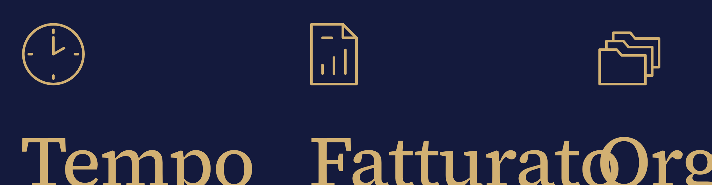
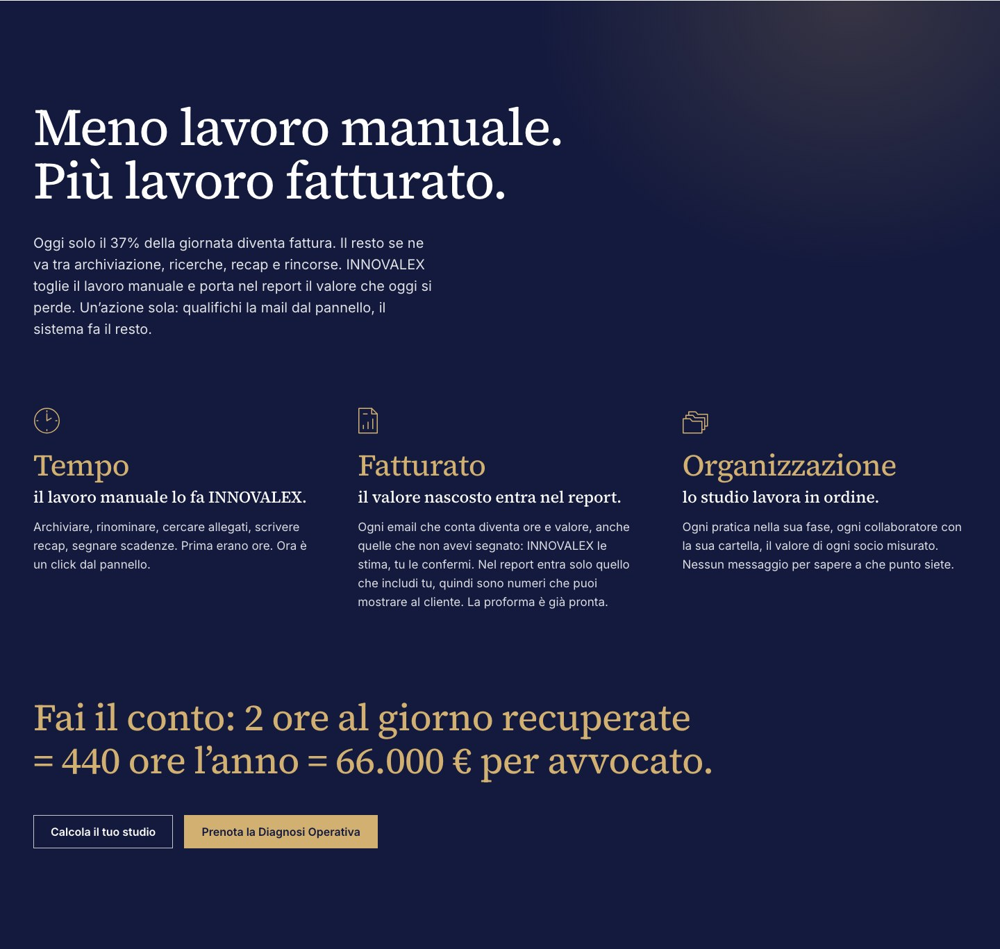
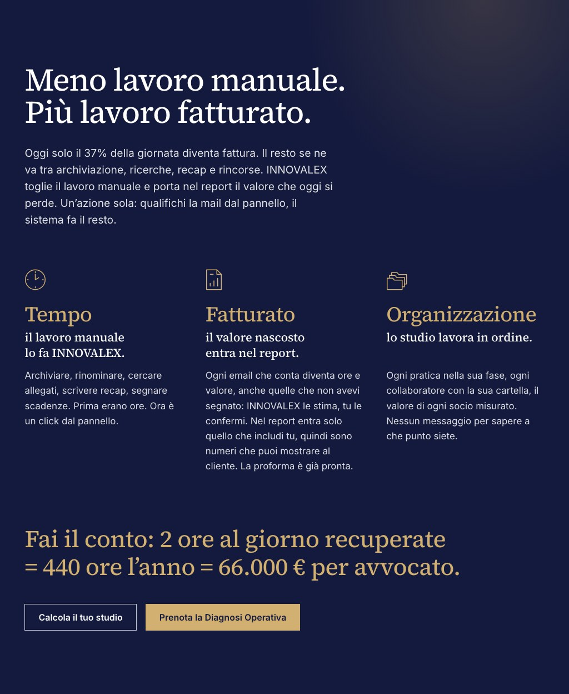
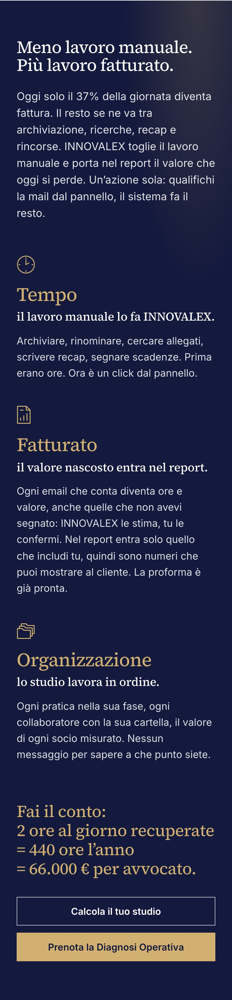

# Fase 4, sessione 2.1: riepilogo finale, gerarchia e icone

Ramo `rifacimento-sito`, commit del lavoro `742a567`. Si è toccata solo la sezione "Meno lavoro manuale. Più lavoro fatturato.".
Non pubblicato: nessun merge su main, nessuna produzione.

## 1. Cosa è cambiato

| Punto | Cosa c'è ora |
|---|---|
| 1. Ordine di lettura | Il testo sta sotto il titolo a ogni larghezza (prima, da 1200 px, stava a destra). Ordine: titolo, testo, tre blocchi, conto in oro, pulsanti. Riga più lunga misurata: 65 caratteri a 1440 e a 1024, 41 a 390 |
| 2. Parola chiave | Ogni titolo di blocco è in due parti. "Tempo", "Fatturato", "Organizzazione" stanno su una riga loro, in oro chiaro, a 43,5 px su 1440 (38 a 1024, 32 a 390). Il resto sta sotto in bianco, a 23,6 px (22 a 1024, 20 a 390). I due punti non si vedono più |
| 3. Icone | Tre icone SVG in linea disegnate per questa sezione, sopra la parola chiave e a filo con il suo bordo sinistro: 40 px da 768 px in su, 32 px sotto. Solo tratto da 1,5 px in oro chiaro, terminazioni e giunti tondi, spigoli vivi. Nessun fondo, cerchio o riquadro dietro, nessun riempimento, nessuna animazione, `aria-hidden="true"` |

**Le tre icone.**

- Tempo: un orologio. Le lancette segnano le due, come le due ore al giorno del conto.
- Fatturato: la pagina del report con l'angolo piegato e tre barre che salgono.
- Organizzazione: tre cartelle di pratica una dietro l'altra.

**Testi.** Invariati, parola per parola. In `src/content/storia.ts` ogni titolo di blocco è diviso in `chiave` e `resto`. Nessun trattino lungo.

## 2. Schermate

**1440**

**1024**

**390**

Le schermate sono fatte senza l'intestazione fissa, che altrimenti copre un pezzo della sezione.

## 3. Verifiche

- **Prove Playwright** (`node scripts/prove-home.mjs <url>`), a 1440, 1024 e 390, con e senza movimento ridotto: **450 su 450 superate** (erano 416, le 34 in più sono di questa sezione).
- **Confronto dei testi [=] con main** (`node scripts/verifica-uguali.mjs <url>`): nessuna differenza, 84 frasi del piano e 90 elementi `data-uguale`.
- **Testi vietati** (`node scripts/verifica-testi.mjs`): nessun problema.
- **JavaScript**: nessun file aggiunto, la pagina continua a non caricarne.
- **Detector di impeccable** sui file cambiati: nessuna segnalazione.

**Contrasti.**

| Coppia | Rapporto | Soglia |
|---|---|---|
| Parola chiave in oro chiaro sul blu | 8,19:1 | 3:1 (testo grande) |
| La stessa, nel punto più chiaro della luce calda in alto a destra | 5,85:1 | 3:1 |
| Resto del titolo, bianco sul blu | 16,87:1 | 3:1 |

Il minimo di tutta la pagina resta 4,64:1, come nella sessione 2.

**Cosa controllano le prove nuove, a ogni larghezza.**

| Area | Controllo |
|---|---|
| Ordine | Titolo, testo, blocchi, conto e pulsanti uno sotto l'altro; testo allineato a sinistra con il titolo |
| Riga | Nessuna riga del testo oltre 65 caratteri |
| Parola chiave | Le tre parole esatte, una riga sola, colore oro chiaro, corpo almeno una volta e mezza quello del resto; resto sotto, in bianco; due punti non a schermo |
| Blocchi in fila (da 1024) | Resto del titolo e testo partono alla stessa altezza nei tre blocchi |
| Icone | Tre SVG in linea diversi tra loro, 40 o 32 px, tratto oro da 1,5 px, terminazioni tonde, a filo sinistro sopra la parola chiave, `aria-hidden`, nessuna immagine o libreria |
| Icone | Nessun fondo, bordo o ombra dietro, nessun riempimento, nessuna animazione o transizione |

## 4. Due scelte da conoscere

| Scelta | Motivo |
|---|---|
| I due punti restano nel codice, invisibili a schermo | A schermo li sostituisce l'a capo. Chi ascolta la pagina con un lettore di schermo non ha l'a capo: con i due punti sente "Tempo: il lavoro manuale lo fa INNOVALEX." con la pausa giusta. Se preferisci toglierli del tutto è una riga |
| Da 1024 px i tre blocchi condividono le righe | A 1024 il resto del titolo va su due righe in due blocchi e su una nel terzo. Con le righe in comune i tre testi partono comunque alla stessa altezza |

## 5. Cosa ha fatto ogni skill

- **frontend-design.** Icone disegnate sul mondo del sito (il report, le cartelle di pratica, le due ore del conto), non prese da un repertorio generico. L'oro resta l'unico colore in più: ora segna le tre parole chiave e il conto.
- **impeccable.** Letto `craft-floor.md` prima delle modifiche. Riga del testo misurata sul testo vero e portata a 65 caratteri. Un solo tratto e un solo peso per le tre icone. Detector senza segnalazioni.

## 6. File toccati

- `src/components/sezioni/Riepilogo.astro`: le icone e il titolo in due parti.
- `src/content/storia.ts`: `chiave` e `resto` per ogni blocco.
- `src/styles/storia.css`: solo la parte del riepilogo.
- `scripts/prove-home.mjs`: le prove nuove.
