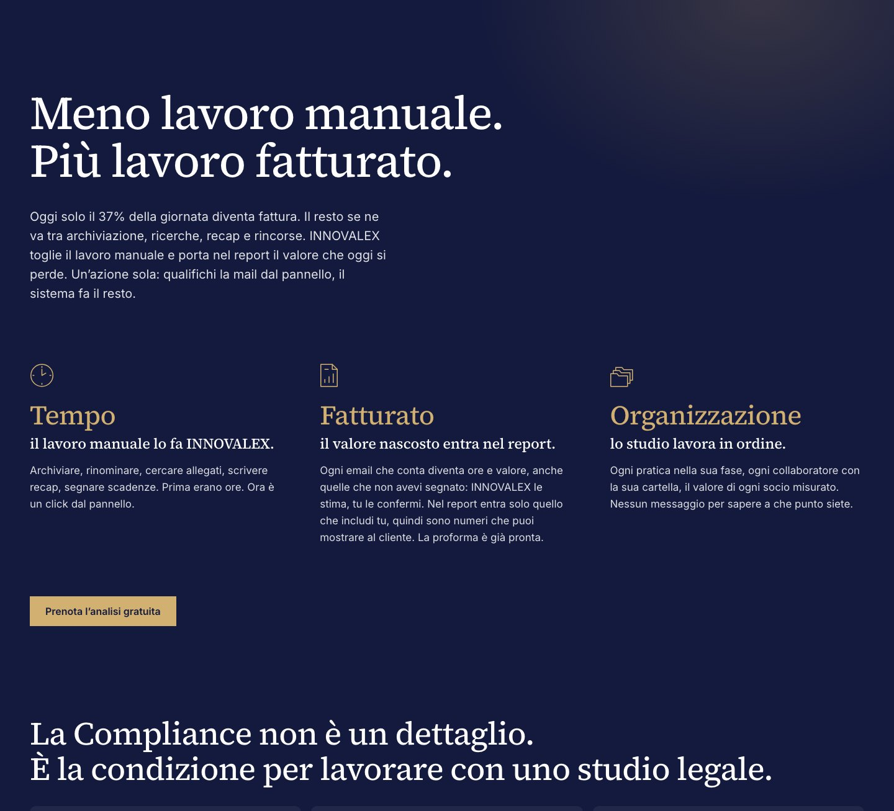
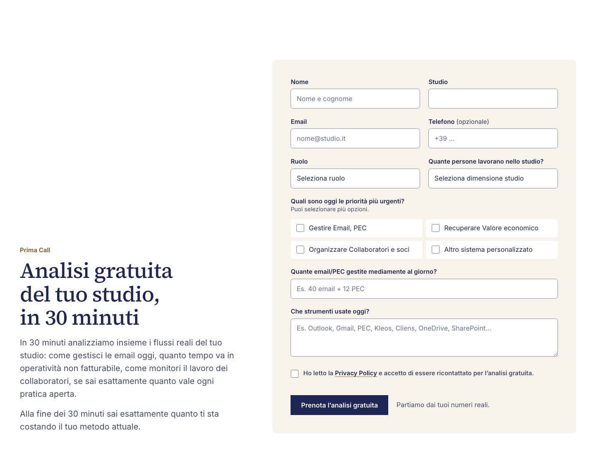
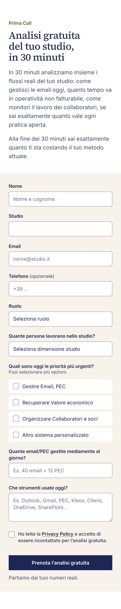

# Fase 4, sessione 2.2: chiusura del riepilogo e nome "analisi gratuita"

Ramo `rifacimento-sito`, commit del lavoro `01f1e5c`. Due decisioni di Federico del 25/11/2026, e solo quelle.
Non pubblicato: nessun merge su main, nessuna produzione, Vercel non toccato.

## 1. Chiusura del riepilogo

Sezione "Meno lavoro manuale. Più lavoro fatturato.".

| Prima | Ora |
|---|---|
| Frase in oro "Fai il conto: 2 ore al giorno recuperate = 440 ore l'anno = 66.000 € per avvocato." | Tolta |
| Pulsante "Calcola il tuo studio" | Tolto |
| Pulsante oro "Prenota la Diagnosi Operativa" | Resta, unico: "Prenota l'analisi gratuita". Porta al form (`#contatti`) |

Il pulsante ha lo stile oro di prima ed è a filo sinistro con il titolo. Su telefono occupa tutta la larghezza.

| Larghezza | Spazio sopra il pulsante (dai tre blocchi) | Spazio sotto (fino alla fine della sezione) |
|---|---|---|
| 1440 | 80 px | 144 px |
| 1024 | 61 px | 114 px |
| 390 | 48 px | 64 px |

Icone, parole chiave e testi dei tre blocchi sono identici a prima.

**1440**



**390**


## 2. "Diagnosi Operativa" diventa "analisi gratuita"

### Sostituzioni fatte

Ho cercato "diagnosi" in ogni pagina costruita del sito (home, pagina interna del sistema grafico, Privacy Policy, Cookie Policy), nel testo e negli attributi che diventano testo.

| N. | Dove | Prima | Dopo |
|---|---|---|---|
| 1 | Menu, pulsante in alto a destra (a ogni larghezza) | Diagnosi Gratuita | Analisi gratuita |
| 2 | Tre sistemi, pulsante dopo Governance Operativa | Prenota la Diagnosi Operativa | Prenota l'analisi gratuita |
| 3 | Riepilogo, pulsante finale | Prenota la Diagnosi Operativa | Prenota l'analisi gratuita |
| 4 | Risultati reali, pulsante | Prenota la Diagnosi Operativa | Prenota l'analisi gratuita |
| 5 | Chi siamo, pulsante finale | Prenota la Diagnosi Operativa | Prenota l'analisi gratuita |
| 6 | Sezione del form, titolo | Diagnosi Operativa in 30 minuti | Analisi gratuita del tuo studio, in 30 minuti |
| 7 | Form, consenso privacy | Ho letto la Privacy Policy e accetto di essere ricontattato per la diagnosi. | Ho letto la Privacy Policy e accetto di essere ricontattato per l'analisi gratuita. |
| 8 | Form, pulsante di invio (anche il testo che torna dopo un invio non riuscito) | Prenota la Diagnosi Operativa. Partiamo dai tuoi numeri reali. | Prenota l'analisi gratuita. Partiamo dai tuoi numeri reali. |
| 9 | Pagina interna `/anteprima/sistema/` (campionario dei pulsanti, non indicizzata), 5 pulsanti | Prenota la diagnosi | Prenota l'analisi gratuita |

Le righe 2, 3, 4, 5 e 8 vengono da due sole stringhe in `src/content/storia.ts`.

### Dove ho controllato e non c'era nulla da cambiare

Voci del menu, testi delle sezioni, FAQ, esiti del form ("Grazie. Ti contatteremo entro 24h.", "Invio non riuscito. Riprova tra pochi minuti."), conferma dopo l'invio, piè di pagina, `title`, meta description, Cookie Policy, testi alternativi ed etichette per i lettori di schermo.

### Lasciato com'è: la Privacy Policy (decisione tua)

`public/privacy-policy.html` contiene ancora tre frasi con "diagnosi". Non le ho toccate: è un testo legale, datato "Ultimo aggiornamento: 4 maggio 2026", identico a quello in produzione su main, e nel progetto i testi legali sono tra quelli da non modificare. Se vuoi allinearle, queste sarebbero le sostituzioni:

| Punto | Ora | Proposta |
|---|---|---|
| Apertura | form di contatto per richieste di diagnosi operativa, demo e approfondimento commerciale | form di contatto per richieste di analisi gratuita, demo e approfondimento commerciale |
| 3. Finalità | preparare la diagnosi operativa e la call iniziale sui flussi reali dello studio | preparare l'analisi gratuita e la call iniziale sui flussi reali dello studio |
| 5. Conservazione | gestione del contatto, della diagnosi iniziale e degli eventuali successivi scambi commerciali | gestione del contatto, dell'analisi iniziale e degli eventuali successivi scambi commerciali |

Il controllo automatico ammette solo queste tre frasi esatte. Qualsiasi altro "diagnosi" lo fa fallire.

### Cosa resta "diagnosi" apposta (non è testo visibile)

- I valori dell'origine del clic inviati a `/api/lead`: `menu-diagnosi`, `sistemi-diagnosi`, `riepilogo-diagnosi`, `risultati-diagnosi`, `founder-demo`.
- Nomi interni: file (`Diagnosi.astro`, `diagnosi.ts`), classi, attributi `data-diagnosi-*`, id e ancore (`#contatti` e le altre).
- `api/lead.js` e `api/roi-lead.js`, non toccati. L'oggetto delle mail interne di avviso continua a cominciare con "[Diagnosi]".
- `src/content/prima-schermata.ts`: file della fase 3 che nessuna pagina usa più. Contiene "Prenota la diagnosi di 30 minuti", che non compare da nessuna parte.

**Sezione del form a 1440**



**Sezione del form a 390**



Le schermate sono fatte senza l'intestazione fissa, che altrimenti copre un pezzo della sezione.

## 3. Confronto dei testi [=] con main

Quattro testi del piano erano marcati [=] e ora sono diversi da main apposta. Lo script (`node scripts/verifica-uguali.mjs <url>`) li elenca a parte come modificati per decisione, non come errori:

```
Frasi [=] del piano: 79. Elementi data-uguale nella pagina: 86.
Modificati per decisione di Federico del 25/11, non sono errori (4 testi del piano, 4 elementi data-modificato):
- Menu: prima "Diagnosi Gratuita", ora "Analisi gratuita"
- 9. Analisi gratuita e form: prima "Diagnosi Operativa in 30 minuti", ora "Analisi gratuita del tuo studio, in 30 minuti"
- 9. Analisi gratuita e form: prima "Prenota la Diagnosi Operativa. Partiamo dai tuoi numeri reali.", ora "Prenota l'analisi gratuita. Partiamo dai tuoi numeri reali."
- 11. Chi siamo: prima "Prenota la Diagnosi Operativa", ora "Prenota l'analisi gratuita"
Nessuna differenza.
```

Come funziona:

- Nel piano la riga ha la data della decisione al posto di [=] e il testo di prima tra parentesi: `[25/11] Pulsante finale: "Prenota l'analisi gratuita" (era "Prenota la Diagnosi Operativa").`
- Nella pagina l'elemento ha `data-modificato="25/11"` al posto di `data-uguale`.
- Per ognuno lo script controlla tre cose: il testo nuovo è nella pagina, il testo di prima era davvero quello di main, il testo di prima non è rimasto nella pagina. Un elemento `data-modificato` senza la sua riga nel piano è un errore.

Prima le frasi [=] erano 84 e gli elementi 90: le 5 frasi e i 4 elementi in meno sono quelli passati tra i modificati.

## 4. Verifiche

- **Prove Playwright** (`node scripts/prove-home.mjs <url>`), a 1440, 1024 e 390, con e senza movimento ridotto, compresi i test del form con chiamata intercettata: **476 su 476 superate** (erano 450, le 26 in più sono di questa sessione).
- **Nessun "Diagnosi Operativa" rimasto**: controllo automatico in due punti.
  - `scripts/verifica-testi.mjs` ha una regola nuova per "diagnosi". Gira a ogni build sulla home e in produzione ferma la build. Ora legge anche meta description, segnaposto dei campi e testi dei pulsanti tenuti negli attributi.
  - Le prove aprono tutte le pagine costruite e cercano "diagnosi", maiuscole o minuscole. Risultato: zero, più le tre frasi della Privacy Policy dichiarate sopra.
- **Contenuto inviato a `/api/lead` e `/api/roi-lead` identico a prima.** Ho registrato le chiamate (intercettate, nulla esce dal browser) prima e dopo le modifiche, in 7 casi: calcolatore con i tre sistemi, form da ognuno dei 5 pulsanti, form senza clic. Le due registrazioni sono identiche byte per byte, orario escluso. Le prove confrontano anche chiavi, ordine e formato con il form di main.
- **Detector di impeccable** sui file cambiati: nessuna segnalazione.
- **Nessun trattino lungo** nei testi e nei file toccati.

**Cosa controllano le prove nuove, a ogni larghezza.**

| Area | Controllo |
|---|---|
| Riepilogo | Conto in oro e "Calcola il tuo studio" assenti; un solo link nella sezione, "Prenota l'analisi gratuita" verso `#contatti` |
| Riepilogo | Il pulsante è l'ultimo elemento, oro, a filo sinistro con il titolo, alto almeno 44 px; spazio sopra tra 48 e 80 px, spazio sotto più grande di quello sopra; a 390 largo quanto la colonna |
| Nome | Pulsante del menu, quattro pulsanti "Prenota l'analisi gratuita", titolo, consenso e pulsante del form con i testi esatti |
| Dati | Origine del clic dei cinque pulsanti identica a prima |

## 5. Piano aggiornato

`docs/PIANO-STORYLINE.md`: legenda con la marca [25/11], menu, sezioni 5, 7, 8, 9 e 11 con il nome nuovo. Nella sezione 7 il riepilogo finisce con un solo pulsante, senza conto in oro e senza "Calcola il tuo studio". Nella sezione 9 ho aggiunto la frase del consenso, che prima nel piano non c'era.

## 6. Cosa ha fatto ogni skill

- **impeccable.** Letto `craft-floor.md` prima delle modifiche. Spazio sopra e sotto il pulsante letto sui valori calcolati a ogni larghezza, non a occhio. Detector senza segnalazioni.
- **unslop-ui.** Passata finale sui testi toccati: nessuna freccia, nessun punto esclamativo, niente da tagliare. Tolto il CSS rimasto senza uso (conto in oro, pulsante chiaro).

## 7. File toccati

- `src/content/storia.ts`: i testi.
- `src/components/sezioni/Riepilogo.astro`, `src/styles/storia.css`: chiusura del riepilogo.
- `src/components/Intestazione.astro`, `src/components/sezioni/Diagnosi.astro`, `src/components/sezioni/ChiSiamo.astro`: `data-modificato` al posto di `data-uguale`.
- `src/pages/anteprima/sistema.astro`: testo dei pulsanti di esempio.
- `scripts/verifica-uguali.mjs`, `scripts/verifica-testi.mjs`, `scripts/prove-home.mjs`: confronto, regola e prove.
- `docs/PIANO-STORYLINE.md`.

Nota tecnica: sul Mac c'è Node 22.14.0 e Astro chiede la 22.23.4. Build e prove sono girate con una Node 22.23.4 già scaricata in locale, la stessa versione di `.nvmrc`.
