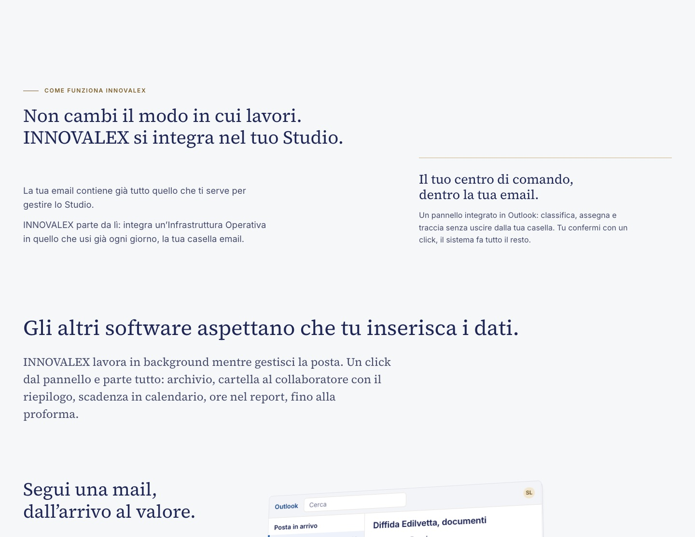
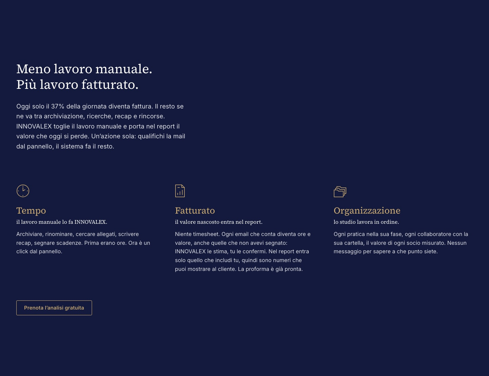

# Fase 4, sessione 4: le leve commerciali della call del 26/11

Ramo `rifacimento-sito`, commit del lavoro `4e746b4`. Non pubblicato: nessun merge su main, Vercel non toccato.

I testi sono quelli approvati da Federico, parola per parola. Le modifiche fatte a mano da Federico (logo di SCLN in Risultati reali, ruolo "Fondatore") sono rimaste come erano. Lo stile è quello della sessione 3: serif regolare, molta aria, oro pieno, linee di 1 px, nessun effetto.

## 1. In breve

1. **Problema.** La timeline ha un sesto orario dopo le 13:00: "Venerdì, 18:30" / "Il timesheet della settimana, ricostruito a memoria."
   - Stesso elemento, stesso stile e stessa accensione degli altri cinque.
   - La colonna degli orari ora è larga quanto "Venerdì, 18:30", uguale in ogni riga, così i sei testi partono dallo stesso bordo.
   - Sotto i 640 px l'orario sta sopra il testo: affiancato, il testo sarebbe rimasto in una colonna di 180 px.
2. **Come funziona.** La frase in evidenza è un paragrafo solo, in serif, su due livelli:
   - la prima frase grande: 44 px a 1440, 28 px a 390;
   - il resto sotto: 24 px a 1440, 19 px a 390, in grigio inchiostro.
   - Sta sotto il titolo della sezione, dopo il testo e il pannello, subito prima della scena a 5 passi. Così fa da ponte: "Un click dal pannello e parte tutto..." introduce la scena che lo mostra.
   - Intorno ha 144 px di spazio sopra e circa 140 sotto (104 e 72 a 390).
3. **Visibilità Economica** è la sezione principale della pagina.
   - Resta tra Ordine Operativo e Governance Operativa, ma in una fascia blu notte a tutta larghezza, l'unica della sezione Sistemi.
   - Dall'alto: etichetta, titolo su due righe al corpo dei titoli di sezione (gli altri due sistemi hanno un titolo più piccolo), testo, la scena del valore che sale (2.775 → 3.750 €) entro metà larghezza.
   - Poi le quattro leve: griglia 2 x 2 da 768 px in su, in colonna sotto. Ognuna ha il titolo in serif da 28 px (22 px a 390), una linea oro sopra e il testo sotto.
   - Nessuna parola su costo, margine, preventivi o "ogni lunedì" (c'è una prova che lo controlla).
4. **Riepilogo.** Il blocco Fatturato comincia con "Niente timesheet.".
5. **Chi siamo.**
   - Titolo invariato e, sotto, il testo nuovo.
   - Scheda di Federico invariata.
   - Per l'Avv. Cocola, al posto della riga di prima, la sua citazione in serif da 23 px, in un `blockquote` dentro una `figure`, con la virgoletta d'apertura appesa al margine.
   - La citazione è registrata "da confermare": in anteprima si vede con l'avviso "Citazione da confermare". Ho provato la build di produzione, in una cartella a parte: si ferma e la citazione è nell'elenco dei motivi.

## 2. Schermate

Build di anteprima, commit `4e746b4`. Le schermate sono state prese dopo uno scorrimento completo, senza l'intestazione fissa, con le animazioni arrivate alla fine.

| Sezione | 1440 | 390 |
|---|---|---|
| Timeline dello spreco, sei orari |  |  |
| Come funziona, con la frase in evidenza |  |  |
| Visibilità Economica |  |  |
| Riepilogo |  |  |
| Chi siamo |  |  |

## 3. Video dello scorrimento

Con movimento, build di anteprima, commit `4e746b4`:

- [1440](https://raw.githubusercontent.com/innovalex-lab/sito-web/4e746b4a49290c0caa7e55495a49a6a26d98f5fd/docs/audit/fase4/s4/scorrimento-1440.webm)
- [390](https://raw.githubusercontent.com/innovalex-lab/sito-web/4e746b4a49290c0caa7e55495a49a6a26d98f5fd/docs/audit/fase4/s4/scorrimento-390.webm)

## 4. Testi e funzioni

Ogni frase nuova è collegata alle sue funzioni in `src/content/funzioni.ts`. La build controlla che siano tutte attive.

| Testo | Funzioni collegate |
|---|---|
| Frase di Come funziona | analisi AI delle mail, pannello, archiviazione, cartella al collaboratore, scadenze, calendario, report e proforma |
| Visibilità Economica, titolo e testo | pannello, report, ore stimate, valore per socio |
| "Niente timesheet." | pannello, ore stimate, report |
| "Quanto vale ogni cliente e ogni pratica." | report, ore stimate |
| "Quanto vale ogni persona dello studio." | valore per socio |
| "Numeri che puoi mostrare al cliente." | report |
| Chi siamo, testo | analisi AI delle mail, pannello, pratiche, archiviazione, report |
| Citazione di Cocola | analisi AI delle mail, pannello, più lo stato "da confermare" |

Il sesto orario della timeline e il blocco Fatturato del riepilogo non citano funzioni nuove: il riepilogo era già collegato a pannello, ore stimate e report.

**Testi [=] sostituiti, marcati [26/11]** nel piano e con `data-modificato="26/11"` nella pagina:

1. Titolo della Visibilità Economica. Era "Il lavoro che fai diventa valore che si vede."
2. Testo di "Valore per socio", ora la leva "Quanto vale ogni persona dello studio." Era "Per ogni socio e collaboratore INNOVALEX traccia pratiche originate, pratiche gestite, ore lavorate e valore economico generato. La base oggettiva per la distribuzione degli utili, senza discussioni e senza memoria."

Gli altri testi tolti dalla Visibilità Economica (il testo "Questo report normalmente non esiste...", "Report economico", "Ore stimate", "Dal report alla parcella") erano [≈] o [+], non [=]: non entrano nel confronto con main.

## 5. Verifiche

- **Prove Playwright:** `node scripts/prove-home.mjs`, a 1440, 1024 e 390, con e senza movimento ridotto: **542 su 542 superate** (erano 476).
  - Prove nuove, a ogni larghezza:
    - sesto orario: testo, stile, accensione, allineamento, a capo su telefono;
    - frase di Come funziona: testo esatto, posizione, serif, due livelli, spazio intorno;
    - Visibilità Economica: fascia a tutta larghezza tra i due sistemi, titolo su due righe, testo, quattro leve esatte in 2 x 2 o in colonna, nessuna parola esclusa;
    - testo del blocco Fatturato;
    - Chi siamo: testo sotto il titolo, citazione di Cocola in serif con l'avviso, riga di prima sparita.
  - Prove aggiornate:
    - testi modificati per decisione: ora 6, quattro del 25/11 e due del 26/11;
    - avvisi dell'anteprima: ora 4, i tre numeri SCLN e la citazione di Cocola.
  - Una prova nuova è fallita al primo giro a 1024: era sbagliata la prova, non la pagina. Misurava l'altezza del `<time>`, che nella griglia si allunga quanto il testo accanto. Ora conta le righe vere del testo.
- **Script di confronto** (`node scripts/verifica-uguali.mjs`): "Nessuna differenza".
  - 76 frasi [=] del piano. Erano 79: le tre frasi sostituite ora sono [26/11].
  - L'elenco dei testi modificati ora è diviso per data, così i due del 26/11 si leggono a parte.
- **Testi vietati** della build: nessuno. Nessun trattino lungo nelle righe aggiunte.
- **Contrasti:** sopra soglia a ogni larghezza. Il minimo è 4,64 su 4,5, invariato ("Cerca" nella lastra di Outlook).
- **Detector di impeccable** sui file cambiati: nessuna segnalazione.
- **Budget**, `scripts/misure-home.mjs`. Prima e dopo sono serviti dallo stesso server statico:

| Misura | Prima (88af206) | Dopo (4e746b4) |
|---|---|---|
| JavaScript (in linea, gzip) | 3,6 KB | 3,6 KB |
| LCP mobile (390, 1,6 Mbps, CPU 4x, mediana di 3) | 1,97 s | 1,90 s |
| LCP desktop | 0,14 s | 0,14 s |
| CLS 1440 / 390 | 0,0002 / 0,0059 | 0,0002 / 0,0059 |
| Fotogrammi oltre 20 ms, 1440 / 390 | 7 / 2 | 6 / 1 |
| **Lunghezza della pagina 1440** | **19.668 px** | **20.998 px** (+1.330, +6,8%) |
| Lunghezza della pagina 1024 | 19.427 px | 20.584 px (+1.157, +6,0%) |
| **Lunghezza della pagina 390** | **23.431 px** | **24.947 px** (+1.516, +6,5%) |

La pagina cresce soprattutto per la fascia della Visibilità Economica (circa 1.500 px a 1440, 2.100 a 390) e per la frase di Come funziona.

## 6. Scelte da rivedere

- **Fascia blu notte.** Le fasce scure diventano tre: il 37% del Problema, la Visibilità Economica, riepilogo e compliance. L'ho scelta perché è l'unico modo di dare a questa sezione il peso più forte della pagina senza effetti. Se preferisci, si può fare bianca su crema: costa una riga di CSS.
- **Lastra piccola "Ore stimate confermate".** Copriva per metà la legenda della scena già nella versione di prima (si leggeva "...rmare"). Nella fascia nuova l'ho posata in basso a destra, sotto la legenda, che ora si legge intera.
- **Posizione della frase di Come funziona.** Rispetta "sotto il titolo, prima della scena", ma dopo il testo e il pannello, non subito sotto il titolo. Messa subito sotto il titolo, due frasi grandi una sopra l'altra si sarebbero fatte concorrenza.

## 7. Cosa ha fatto ogni skill

- **frontend-design, design-taste-frontend.** Le ho usate per il giudizio sulle schermate, non per cambiare direzione. Le loro regole vietano etichette in maiuscolo e linee sottili, ma qui le chiede il brief, e vince il brief.
  - Dalle schermate: il vuoto sotto il testo della Visibilità Economica a 1440, risolto mettendo il testo a metà altezza della scena, un po' più grande;
  - e la lastra piccola sulla legenda.
- **impeccable.** Letto `craft-floor.md` prima delle modifiche. Valori letti nel browser, non a occhio; detector pulito.
- **unslop-ui.** Passata finale sulla resa, senza riscrivere testi. Nessun numero decorativo, nessuna freccia, nessun bordo colorato spesso, nessuna icona aggiunta.
  - L'etichetta "Visibilità Economica" resta: la chiede il brief.

## 8. File toccati

- **Testi e verifica:**
  - `src/content/storia.ts`: timeline, frase, Visibilità Economica, Fatturato, Chi siamo;
  - `src/content/funzioni.ts`: citazione di Cocola con il suo stato;
  - `src/content/verifica.ts`: controllo delle citazioni in Chi siamo.
- **Componenti:**
  - `Problema.astro`, `ComeFunziona.astro`, `ChiSiamo.astro`;
  - `Sistemi.astro`: la fascia;
  - `SistemaAffiancato.astro`, nuovo: lo schema comune di Ordine e Governance, prima scritto due volte.
- **Stili:** `src/styles/storia.css`.
- **Prove e confronto:** `scripts/prove-home.mjs`, `scripts/verifica-uguali.mjs`.
- **Piano:** `docs/PIANO-STORYLINE.md`, sezioni 2, 4, 5, 7 e 11, legenda e punti da confermare.
- **Schermate e video:** `docs/audit/fase4/s4/`.

Nota tecnica: build e prove girate con Node 22.23.4, come `.nvmrc`.
